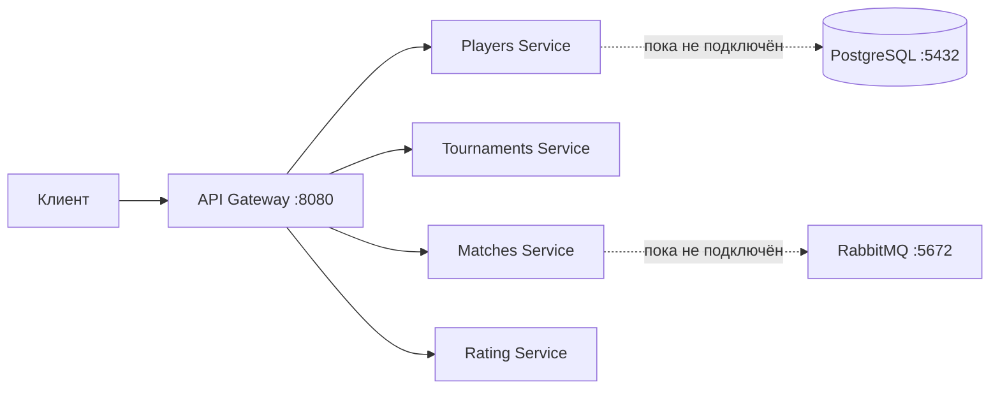

# TournamentPlatform

TournamentPlatform - платформа для организации спортивных и киберспортивных турниров. Она предназначена для организаторов, игроков и зрителей: в целевой версии организаторы смогут проводить турниры, а участники и зрители — следить за матчами и рейтингами.

## Технологический стек

- .NET 10 и ASP.NET Core Web API;
- YARP Reverse Proxy для API Gateway;
- PostgreSQL 17.6;
- RabbitMQ 4.1 Management;
- Docker и Docker Compose;
- xUnit;
- GitHub Actions CI.

## Архитектура



[Архитектура](docs/ARCHITECTURE.md).

## Быстрый старт

### Требования

- Docker Desktop с запущенным Docker Engine;
- доступ к сети для загрузки базовых Docker-образов при первом запуске.
- .NET 10 SDK.

### Запуск

Из корневой папки репозитория выполните:

```bash
docker compose up --build
```

### Адреса и порты

| Компонент | Адрес с компьютера |
|---|---|
| API Gateway | `http://localhost:8080` |
| PostgreSQL | `localhost:5432` |
| RabbitMQ AMQP | `localhost:5672` |
| RabbitMQ Management | `http://localhost:15672` |
| Players, Tournaments, Matches, Rating | только внутри Compose-сети, порт `8080` |

### Проверка запуска

Проверить Gateway:

```text
GET http://localhost:8080/health
```

Доступные маршруты:

- `GET /api/v1/players` — пустой список игроков;
- `GET /api/v1/teams` — пустой список команд;
- `GET /api/v1/tournaments` — пустой список турниров;
- `GET /api/v1/matches/{matchId}` — заглушка, возвращает `404`;
- `GET /api/v1/ratings/players/{playerId}` и `GET /api/v1/ratings/teams/{teamId}` — заглушки, возвращают `404`;
- `GET /api/v1/ratings/leaderboard` — пустой список.

## Реализованная функциональность

### Уже работает

- запуск API Gateway и четырёх ASP.NET Core сервисов через Docker Compose;
- маршрутизация запросов Gateway в сервисы;
- проверки доступности сервисов через `/health`;
- тестовые пустые ответы для списков игроков, команд, турниров и рейтингов;
- запуск PostgreSQL и RabbitMQ с локальными демонстрационными настройками.

### В планах

- регистрация и управление игроками и командами;
- создание турниров и регистрация участников;
- генерация олимпийских, круговых и швейцарских турниров;
- управление матчами и результатами;
- расчёт рейтинга Эло и обновления в реальном времени;
- подключение PostgreSQL и RabbitMQ к сервисам;
- аутентификация, тесты, CI и клиентское приложение.

## Тесты и CI

В разработке

## Структура репозитория

```text
.
├── docs/
│   ├── ARCHITECTURE.md       # Архитектура и контракты API
│   └── PLAN.md               # План учебной практики
├── src/
│   ├── ApiGateway/           # YARP API Gateway
│   ├── PlayersService/       # Игроки и команды
│   ├── TournamentsService/   # Турниры
│   ├── MatchesService/       # Матчи и результаты
│   └── RatingService/        # Рейтинги
├── docker-compose.yml        # Локальный запуск компонентов
├── .dockerignore             # Исключения из контекста Docker-сборки
├── TournamentPlatform.slnx   # Решение .NET
└── README.md
```

## План работ

Текущий план находится в [docs/PLAN.md](docs/PLAN.md).

## Ограничения и планы развития

Текущие сервисы — каркас: данные не сохраняются, учётные записи приложения отсутствуют, база данных и брокер сообщений пока не используются кодом сервисов.
