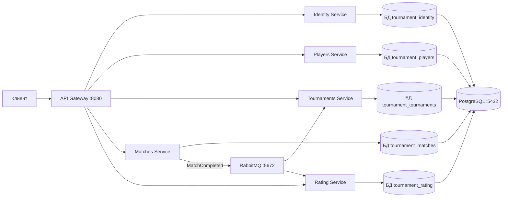

# TournamentPlatform

TournamentPlatform - платформа для организации спортивных и киберспортивных турниров между командами. Игроки создают команды и управляют составом; участниками турниров и рейтинга являются только команды.

## Технологический стек

- .NET 10 и ASP.NET Core Web API;
- YARP Reverse Proxy для API Gateway;
- PostgreSQL 17.6;
- RabbitMQ 4.1 Management;
- Docker и Docker Compose;
- xUnit;
- GitHub Actions CI;
- HTML, CSS и JavaScript для клиентского приложения.

## Архитектура



[Архитектура](docs/ARCHITECTURE.md).

## Быстрый старт

### Требования

- Компьютер с Windows, macOS или Linux и доступом в интернет при первой сборке;
- Docker Desktop (Windows/macOS) либо Docker Engine + Docker Compose Plugin (Linux);
- запущенный Docker Engine;
- Git для клонирования репозитория.

.NET SDK для запуска через Docker не требуется: сервисы собираются внутри Docker-образов. Он понадобится, если вы хотите отдельно собирать или запускать проект из исходников.

### Запуск на чистой машине

1. Установите и запустите Docker Desktop (или Docker Engine и Compose Plugin на Linux). Убедитесь, что Docker сообщает о готовности.
2. Клонируйте репозиторий и перейдите в него:

```bash
git clone https://github.com/Neyvk/TournamentPlatform.git
cd TournamentPlatform
```

3. Из корневой папки проекта выполните:

```bash
docker compose up --build
```

Когда контейнеры запустились, откройте `http://localhost:8080`.

Если порт `8080`, `5432`, `5672` или `15672` уже занят, остановите приложение, которое его использует, либо измените публикацию соответствующего порта в `docker-compose.yml`.

### Адреса и порты

| Компонент | Адрес с компьютера |
|---|---|
| Клиентское приложение и API Gateway | `http://localhost:8080` |
| PostgreSQL | `localhost:5432` |
| RabbitMQ AMQP | `localhost:5672` |
| RabbitMQ Management | `http://localhost:15672` |
| Identity, Players, Tournaments, Matches, Rating | только внутри Compose-сети, порт `8080` |

### Проверка запуска

Проверить Gateway:

```text
GET http://localhost:8080/health
```

Доступные маршруты:

- `POST /api/v1/auth/register` — создать учётную запись и базовый профиль с email и уникальным никнеймом;
- `POST /api/v1/auth/login` — войти по email или никнейму и получить JWT;
- `GET /api/v1/players` — список зарегистрированных профилей игроков;
- `GET /api/v1/teams` — список команд;
- `POST /api/v1/teams` — создать команду (нужен JWT);
- `POST /api/v1/teams/{teamId}/members` — вступить в команду (нужен JWT);
- `DELETE /api/v1/teams/{teamId}/members/me` — выйти из команды;
- `DELETE /api/v1/teams/{teamId}/members/{playerId}` — владелец исключает участника;
- `DELETE /api/v1/teams/{teamId}` — владелец удаляет команду;
- `POST /api/v1/tournaments` — создать командный турнир (нужен JWT; создатель становится организатором);
- `GET /api/v1/tournaments` — список созданных турниров;
- `GET /api/v1/tournaments/{id}` — получить турнир;
- `POST /api/v1/tournaments/{id}/teams` — зарегистрировать команду (нужен JWT владельца команды);
- `POST /api/v1/tournaments/{id}/start` — запустить турнир (нужен JWT организатора);
- `GET /api/v1/matches/tournaments/{id}` — получить матчи турнира;
- `PUT /api/v1/matches/{matchId}/result` — сохранить счёт матча (нужен JWT организатора турнира) и продолжить турнир;
- `GET /api/v1/matches/{matchId}` — получить матч;
- `GET /api/v1/ratings/teams/{teamId}` — получить рейтинг команды;
- `GET /api/v1/ratings/leaderboard?limit=50` — таблица командных рейтингов.

Для защищённых запросов передавай заголовок `Authorization: Bearer <accessToken>` с токеном из `/api/v1/auth/login`.

## Реализованная функциональность

### Уже работает

- запуск API Gateway и пяти ASP.NET Core сервисов через Docker Compose;
- веб-клиент для регистрации и входа, просмотра игроков, управления командами и турнирами, матчей и рейтинга;
- автообновление открытого раздела приложения каждые 3 секунды;
- регистрация пользователя вместе с базовым профилем (email и никнейм), вход по email или никнейму с выдачей JWT;
- хранение учётных записей и хэшей паролей в PostgreSQL через ASP.NET Core Identity;
- маршрутизация запросов Gateway в сервисы;
- проверки доступности сервисов через `/health`;
- создание базового профиля игрока при регистрации и получение списка профилей;
- создание турниров только для команд: `olympic` (2–128 команд), `round_robin` (2–16) или `swiss` (2–256, от 1 до 20 раундов);
- создание команд, вступление и выход участников, кик участника владельцем и удаление команды;
- генерация матчей кругового турнира, олимпийской и швейцарской сеток;
- сохранение результата матча, создание следующих раундов в олимпийской и швейцарской сетках и завершение турнира;
- проверка JWT и прав организатора при запуске турнира и фиксации результатов;
- рейтинг команд: для начальных команд из топ-10 HLTV используются очки рейтинга HLTV, новые команды начинают с 1000; после матчей рейтинг пересчитывается по Эло;
- публикация события `MatchCompleted` в RabbitMQ и отдельная обработка турнирной сетки и рейтинга;
- запуск PostgreSQL и RabbitMQ с локальными демонстрационными настройками.

### В планах

## Тесты и CI

CI GitHub Actions восстанавливает зависимости, собирает решение и запускает тесты при push в `main` и при pull request в `main`. Для локального запуска тестов установите .NET 10 SDK, затем выполните из корня репозитория `dotnet test`.

## Структура репозитория

```text
.
├── docs/
│   ├── ARCHITECTURE.md       # Архитектура и контракты API
│   └── PLAN.md               # План учебной практики
├── src/
│   ├── ApiGateway/           # YARP API Gateway и веб-клиент
│   ├── IdentityService/      # Регистрация, вход и JWT
│   ├── PlayersService/       # Игроки и команды
│   ├── TournamentsService/   # Турниры
│   ├── MatchesService/       # Матчи и результаты
│   ├── RatingService/        # Командные рейтинги
│   └── Messaging/            # События и обмен через RabbitMQ
├── docker-compose.yml        # Локальный запуск компонентов
├── docker/
│   └── postgres/             # Инициализация баз данных PostgreSQL
├── .dockerignore             # Исключения из контекста Docker-сборки
├── TournamentPlatform.slnx   # Решение .NET
└── README.md
```

## План работ

Текущий план находится в [docs/PLAN.md](docs/PLAN.md).

## Ограничения и планы развития

- В Compose используется одна учётная запись PostgreSQL для отдельных баз сервисов; строгого разделения прав БД нет.
- Для создания схемы в Development применяется `EnsureCreated` и SQL-команды, полноценные EF Core migrations не настроены.
- Клиент обновляет открытый раздел периодическими запросами раз в 3 секунды, без SignalR/WebSocket.
- Доступ проверяется по JWT и владельцу ресурса; роли пользователей не реализованы.

