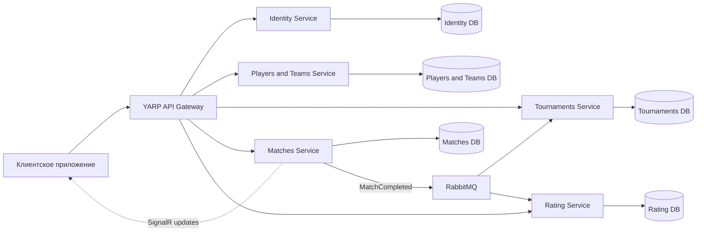
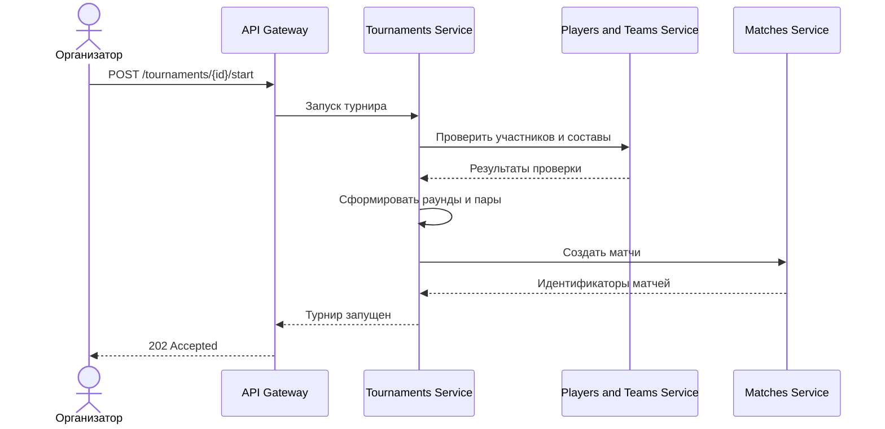
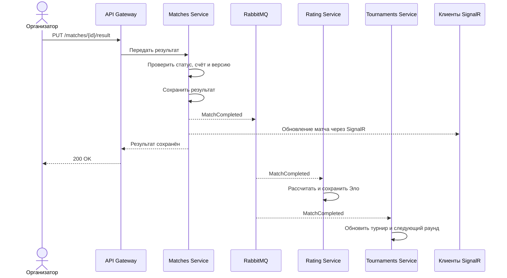

# Архитектура системы

## 1. Цель и контекст

TournamentPlatform — платформа для создания и проведения турниров. Система поддерживает игроков и команды, турниры, матчи и рейтинг Эло. Пользователи могут просматривать открытые турниры, сетки и рейтинги; игроки — регистрироваться в турнирах; организаторы — создавать турниры и фиксировать результаты.

Основные сценарии:

1. Организатор создаёт турнир, выбирает формат и открывает регистрацию.
2. Игрок или команда подаёт заявку на участие.
3. Организатор запускает турнир, система формирует матчи.
4. Организатор фиксирует результат матча.
5. Система обновляет турнирную сетку и рейтинг участников.
6. Клиенты получают обновление результата в реальном времени.

Система поддерживает олимпийскую, круговую и швейцарскую системы. Лента событий в проект не входит.

## 2. Требования

### Функциональные требования

- Создание и просмотр профилей игроков и команд.
- Управление составом команды.
- Создание турниров, регистрация участников и управление статусом турнира.
- Генерация матчей и турнирной сетки или расписания.
- Фиксация результатов матчей и продвижение победителей.
- Расчёт и просмотр рейтинга Эло для игроков и команд.
- Передача обновлений о результатах подключённым клиентам в реальном времени.

### Нефункциональные требования и ограничения

- Сервисы запускаются локально одной командой через Docker Compose.
- Каждый сервис владеет своей базой данных и не читает таблицы других сервисов напрямую.
- Защищённые операции требуют аутентификации и проверки роли на сервере.
- Повторная обработка сообщения не должна повторно применять результат матча или изменение рейтинга.
- Конкурентные изменения результата матча обнаруживаются и возвращают конфликт.
- Для ключевой бизнес-логики генерации сеток и расчёта Эло пишутся автоматические тесты.
- Для диагностики используются структурированные логи, health checks и correlation ID.

## 3. Общая схема

Клиент обращается к сервисам через API Gateway. Сервисы обмениваются запросами через HTTP API, а завершение матча публикуется через RabbitMQ. Обновления результата для клиентов передаются через SignalR.



В каждой базе хранятся только данные соответствующего сервиса. Внешние сущности представлены идентификаторами; межсервисные связи не оформляются внешними ключами между базами.

## 4. Описание сервисов

### API Gateway

**Ответственность:** единая точка входа, маршрутизация запросов, передача токена авторизации и настройка внешних адресов сервисов.

**База данных:** отсутствует.

**Основные маршруты:** `/api/v1/players/**`, `/api/v1/teams/**`, `/api/v1/tournaments/**`, `/api/v1/matches/**`, `/api/v1/ratings/**`.

**События:** не публикует и не потребляет.

### Identity Service

**Ответственность:** регистрация и аутентификация пользователей, выпуск JWT, управление ролями.

**Основные эндпоинты:**

- `POST /api/v1/auth/register`
- `POST /api/v1/auth/login`
- `GET /api/v1/auth/me`

**Своя БД:** пользователи, хэши паролей, роли и настройки аутентификации.

**События:** для первой версии не публикует и не потребляет.

### Players and Teams Service

**Ответственность:** профили игроков, команды и составы команд.

**Основные эндпоинты:**

- `POST /api/v1/players`
- `GET /api/v1/players/{playerId}`
- `GET /api/v1/players`
- `POST /api/v1/teams`
- `GET /api/v1/teams/{teamId}`
- `POST /api/v1/teams/{teamId}/members`
- `DELETE /api/v1/teams/{teamId}/members/{playerId}`

**Своя БД:** игроки, команды, участники команд.

**События:** для первой версии не публикует и не потребляет.

### Tournaments Service

**Ответственность:** создание турниров, регистрация участников, переходы между статусами, правила формата, просмотр турнирной сетки или расписания.

**Основные эндпоинты:**

- `POST /api/v1/tournaments`
- `GET /api/v1/tournaments`
- `GET /api/v1/tournaments/{tournamentId}`
- `POST /api/v1/tournaments/{tournamentId}/entries`
- `DELETE /api/v1/tournaments/{tournamentId}/entries/{entryId}`
- `POST /api/v1/tournaments/{tournamentId}/start`
- `GET /api/v1/tournaments/{tournamentId}/bracket`

**Своя БД:** турниры, заявки участников, настройки формата и раунды.

**Публикуемые события:** в первой версии не публикует.

**Потребляемые события:** `MatchCompleted` для обновления состояния турнира и определения следующего шага формата.

### Matches Service

**Ответственность:** создание и хранение матчей, проверка и фиксация результатов, предоставление обновлений в реальном времени.

**Основные эндпоинты:**

- `GET /api/v1/matches/{matchId}`
- `GET /api/v1/tournaments/{tournamentId}/matches`
- `PUT /api/v1/matches/{matchId}/result`
- SignalR Hub: `/hubs/matches`

**Своя БД:** матчи, участники матча, счёт, победитель, статус и версия записи.

**Публикуемые события:** `MatchCompleted`.

**Потребляемые события:** для первой версии не потребляет.

### Rating Service

**Ответственность:** расчёт и предоставление рейтинга Эло игроков и команд.

**Основные эндпоинты:**

- `GET /api/v1/ratings/players/{playerId}`
- `GET /api/v1/ratings/teams/{teamId}`
- `GET /api/v1/ratings/leaderboard?type=player&limit=50`

**Своя БД:** текущие рейтинги и история изменений рейтинга.

**Публикуемые события:** для первой версии не публикует.

**Потребляемые события:** `MatchCompleted`.

### Событие `MatchCompleted`

Сообщение содержит уникальный идентификатор события, идентификатор матча и турнира, тип участников, идентификаторы участников, счёт, победителя и время завершения матча. Уникальный идентификатор используется для защиты от повторной обработки.

## 5. Модель данных

### Identity Service

- `Users`: идентификатор, имя пользователя, хэш пароля, дата создания.
- `Roles`: идентификатор и название роли.
- `UserRoles`: связь пользователей и ролей.

### Players and Teams Service

- `Players`: идентификатор, отображаемое имя, игровые профили, дата создания.
- `Teams`: идентификатор, название, владелец.
- `TeamMembers`: идентификатор команды, идентификатор игрока, роль в составе, даты вступления и выхода.

### Tournaments Service

- `Tournaments`: идентификатор, название, формат, тип участника (игрок или команда), статус, владелец, лимит участников, даты.
- `TournamentEntries`: идентификатор турнира, тип и идентификатор участника, посев, статус заявки.
- `TournamentRounds`: идентификатор турнира, номер раунда, статус и время начала.

### Matches Service

- `Matches`: идентификатор, идентификатор турнира, номер раунда, позиция, идентификаторы участников, счёт, победитель, статус, версия.
- Внешние идентификаторы участников и турнира хранятся как значения, проверяемые при обращении к соответствующему сервису.

### Rating Service

- `Ratings`: тип участника, идентификатор участника, текущее значение рейтинга, дата обновления.
- `RatingChanges`: идентификатор матча, участник, рейтинг до матча, величина изменения, рейтинг после матча, коэффициент K, время расчёта.
- `ProcessedEvents`: идентификатор обработанного сообщения для идемпотентности.

## 6. Взаимодействие сервисов

### Синхронные вызовы

- Клиент вызывает сервисы через API Gateway.
- Tournaments Service при регистрации и запуске турнира проверяет идентификаторы участников через Players and Teams Service.
- Tournaments Service передаёт сформированные матчи в Matches Service.
- Чтение публичных данных выполняется через API соответствующего сервиса.

### Асинхронные события

После фиксации результата Matches Service публикует `MatchCompleted` в RabbitMQ. Rating Service рассчитывает рейтинг, а Tournaments Service обновляет состояние турнира. Идентификатор события сохраняется потребителем, чтобы повторная доставка не вызвала повторный эффект.

### Сценарий: запуск турнира



### Сценарий: завершение матча



## 7. Безопасность

- Аутентификация выполняется через Identity Service.
- Клиент получает JWT после входа и передаёт его в заголовке `Authorization: Bearer`.
- Роли проверяются на сервере:
  - `Player` — управление собственным профилем и подача заявки;
  - `Organizer` — управление своими турнирами и ввод результатов;
  - `Admin` — административные операции.
- Пароли хранятся только в виде хэшей средствами ASP.NET Core Identity.
- Секрет JWT, пароли БД и другие чувствительные значения передаются через переменные окружения или локальный файл `.env`, который не добавляется в Git.
- Все изменения результата проверяют права организатора и допустимость текущего состояния матча.
- SignalR-подключение к закрытым данным требует авторизации.

## 8. Развёртывание и конфигурация

Локальная система запускается через Docker Compose. В состав входят API Gateway, сервисы, PostgreSQL и RabbitMQ. Каждый сервис получает собственную строку подключения к своей базе или схеме.

Распределение портов для локальной разработки:

| Компонент | Порт хоста |
|---|---:|
| API Gateway | 8080 |
| Identity Service | 8081 |
| Players and Teams Service | 8082 |
| Tournaments Service | 8083 |
| Matches Service | 8084 |
| Rating Service | 8085 |
| PostgreSQL | 5432 |
| RabbitMQ AMQP | 5672 |
| RabbitMQ Management UI | 15672 |

Клиент обращается только к Gateway. Внутренние сервисы доступны в сети Docker Compose по именам контейнеров.

Пример переменных окружения:

ASPNETCORE_ENVIRONMENT=Development
JWT_SIGNING_KEY=
IDENTITY_DB_CONNECTION=
PLAYERS_DB_CONNECTION=
TOURNAMENTS_DB_CONNECTION=
MATCHES_DB_CONNECTION=
RATING_DB_CONNECTION=
RABBITMQ_HOST=rabbitmq
RABBITMQ_USERNAME=
RABBITMQ_PASSWORD=

Реальные значения секретов не хранятся в репозитории. Для развёртывания применяются зафиксированные версии Docker-образов. Миграции базы данных применяются при подготовке окружения или отдельной командой.

## 9. Принятые решения

| Решение | Альтернатива | Причина |
|---|---|---|
| Отдельный сервис рейтинга | Считать рейтинг внутри Matches Service | Расчёт рейтинга можно тестировать и изменять независимо от жизненного цикла матча |
| RabbitMQ для завершённых матчей | Синхронный вызов Rating Service из Matches Service | Очередь снижает связанность и позволяет повторить обработку после временного сбоя |
| SignalR для обновления результата | Периодический опрос API | SignalR быстрее доставляет обновление интерфейсу |

## 10. Ограничения и развитие

- Результаты в первой версии вводит организатор.
- Масштабирование и отказоустойчивость рассчитаны на учебный проект, а не на высоконагруженную коммерческую платформу.
- Возможное развитие: рейтинговые сезоны, история рейтинга на графике, уведомления.

## 11. Контракты API

Базовый адрес API: `http://localhost:8080/api/v1`. Все тела запросов и ответов используют JSON. Идентификаторы передаются в формате UUID, дата и время — в UTC по ISO 8601.

Для защищённых операций клиент передаёт JWT в заголовке `Authorization: Bearer <token>`. Ошибки возвращаются в формате `ProblemDetails`:

```json
{
  "type": "about:blank",
  "title": "Conflict",
  "status": 409,
  "detail": "Турнир уже запущен.",
  "instance": "/api/v1/tournaments/9fa47e15-2493-417a-9592-347d9f84f85d"
}
```

Основные коды ошибок: `400` — неверные данные, `401` — требуется вход, `403` — недостаточно прав, `404` — ресурс не найден, `409` — конфликт состояния или повторная операция, `412` — версия ресурса устарела.

### Игроки

#### Создать учётную запись и профиль игрока

`POST /auth/register` — создаёт учётную запись и связанный с ней базовый профиль игрока.

Запрос:

```json
{
  "email": "player@example.com",
  "nickname": "PlayerOne",
  "password": "demo1234"
}
```

При успешном запросе возвращается `201 Created`:

```json
{
  "userId": "a72dc499-589a-4480-8f44-7b1d4bf1f433",
  "nickname": "PlayerOne",
  "email": "player@example.com"
}
```

После создания учётной записи Identity Service вызывает Players Service внутренним запросом `POST /internal/player-profiles` с `userId` и `nickname`. Этот внутренний маршрут не является клиентским API.

#### Получить профиль игрока

`GET /players/{playerId}` — публичный.

Ответ `200 OK` возвращает профиль.

#### Найти игроков

`GET /players?query=player&limit=20` — публичный. Параметры `query` и `limit` необязательны; максимальный `limit` — 100. Ответ `200 OK` содержит массив профилей.

### Команды

#### Создать команду

`POST /teams` — роль `Player`.

Запрос:

```json
{
  "name": "Team Alpha"
}
```

Ответ `201 Created`:

```json
{
  "id": "05fe6c05-8c49-4456-97bf-4ec700fbf25c",
  "name": "Team Alpha",
  "members": []
}
```

#### Получить команду и её состав

`GET /teams/{teamId}` — публичный. Ответ `200 OK`:

```json
{
  "id": "05fe6c05-8c49-4456-97bf-4ec700fbf25c",
  "name": "Team Alpha",
  "members": [
    {
      "playerId": "a72dc499-589a-4480-8f44-7b1d4bf1f433",
      "displayName": "PlayerOne",
      "role": "captain"
    }
  ]
}
```

#### Изменить состав команды

- `POST /teams/{teamId}/members` — добавить игрока. Роль: владелец команды или `Admin`. Тело запроса: `{"playerId":"a72dc499-589a-4480-8f44-7b1d4bf1f433","role":"captain"}`. Успешный ответ: `204 No Content`.
```json
{
    "playerId":"a72dc499-589a-4480-8f44-7b1d4bf1f433",
    "role":"captain"
}
```
- `DELETE /teams/{teamId}/members/{playerId}` — удалить игрока. Роль: владелец команды или `Admin`. Успешный ответ: `204 No Content`.

Если команда или игрок не найдены, возвращается `404`; если операция несовместима с текущим составом — `409`.

### Турниры

#### Создать турнир

`POST /tournaments` — роль `Organizer`.

```json
{
  "name": "Autumn Cup",
  "format": "single_elimination",
  "participantType": "team",
  "maxParticipants": 16,
  "registrationClosesAt": "2026-11-15T18:00:00Z",
  "rules": {
    "bestOf": 3
  }
}
```

Допустимые значения `format`: `single_elimination`, `olympic`, `swiss`. Допустимые значения `participantType`: `player`, `team`. Ответ `201 Created`:

```json
{
  "id": "9fa47e15-2493-417a-9592-347d9f84f85d",
  "name": "Autumn Cup",
  "format": "single_elimination",
  "participantType": "team",
  "maxParticipants": 16,
  "status": "registration",
  "registrationClosesAt": "2026-11-15T18:00:00Z"
}
```

#### Просмотр турниров

- `GET /tournaments?status=registration&format=single_elimination&limit=20` — список турниров с необязательными фильтрами, публичный; ответ `200 OK` — массив.
- `GET /tournaments/{tournamentId}` — сведения о турнире, публичный; ответ `200 OK` — объект турнира.

#### Подать или отменить заявку

`POST /tournaments/{tournamentId}/entries` — роль `Player`; для командной заявки — капитан команды.

```json
{
  "participantType": "team",
  "participantId": "05fe6c05-8c49-4456-97bf-4ec700fbf25c"
}
```

Ответ `201 Created`:

```json
{
  "id": "2c3acb86-3a25-4c5d-a3bf-41cf17194186",
  "tournamentId": "9fa47e15-2493-417a-9592-347d9f84f85d",
  "participantType": "team",
  "participantId": "05fe6c05-8c49-4456-97bf-4ec700fbf25c",
  "seed": null,
  "status": "accepted"
}
```

Если регистрация закрыта, достигнут лимит или участник уже зарегистрирован, возвращается `409 Conflict`.

`DELETE /tournaments/{tournamentId}/entries/{entryId}` — отменить заявку. Доступно участнику заявки или организатору турнира. Успешный ответ: `204 No Content`.

#### Запустить турнир

`POST /tournaments/{tournamentId}/start` — владелец турнира или `Admin`.

Ответ `202 Accepted`:

```json
{
  "tournamentId": "9fa47e15-2493-417a-9592-347d9f84f85d",
  "status": "in_progress",
  "message": "Турнир запущен. Матчи формируются."
}
```

Запуск возвращает `409 Conflict`, если состояние турнира не допускает запуск или участников недостаточно.

#### Получить сетку или расписание

`GET /tournaments/{tournamentId}/bracket` — публичный. Ответ `200 OK` содержит раунды и матчи. Для кругового формата возвращаются матчи всех туров; для швейцарского следующие пары могут формироваться после завершения предыдущего раунда.

```json
{
  "tournamentId": "9fa47e15-2493-417a-9592-347d9f84f85d",
  "format": "single_elimination",
  "rounds": [
    {
      "number": 1,
      "matches": [
        {
          "id": "10b2a9cd-13d2-4d66-a144-42d06e550ab1",
          "participantAId": "05fe6c05-8c49-4456-97bf-4ec700fbf25c",
          "participantBId": "30be4f53-5c00-4b42-991f-671019207a18",
          "scoreA": null,
          "scoreB": null,
          "winnerId": null,
          "status": "scheduled"
        }
      ]
    }
  ]
}
```

### Матчи

#### Получить матч или матчи турнира

- `GET /matches/{matchId}` — публичный; ответ `200 OK` — объект матча.
- `GET /tournaments/{tournamentId}/matches?round=1` — публичный; `round` необязателен, ответ `200 OK` — массив матчей.

Пример объекта матча:

```json
{
  "id": "10b2a9cd-13d2-4d66-a144-42d06e550ab1",
  "tournamentId": "9fa47e15-2493-417a-9592-347d9f84f85d",
  "round": 1,
  "participantAId": "05fe6c05-8c49-4456-97bf-4ec700fbf25c",
  "participantBId": "30be4f53-5c00-4b42-991f-671019207a18",
  "scoreA": null,
  "scoreB": null,
  "winnerId": null,
  "status": "scheduled",
  "version": 1
}
```

#### Зафиксировать результат

`PUT /matches/{matchId}/result` — владелец турнира или `Admin`. Заголовок `If-Match` содержит версию матча для обнаружения конкурентного изменения.

```http
PUT /matches/10b2a9cd-13d2-4d66-a144-42d06e550ab1/result
If-Match: "1"
Content-Type: application/json
```

```json
{
  "scoreA": 2,
  "scoreB": 1
}
```

Ответ `200 OK`:

```json
{
  "id": "10b2a9cd-13d2-4d66-a144-42d06e550ab1",
  "tournamentId": "9fa47e15-2493-417a-9592-347d9f84f85d",
  "round": 1,
  "participantAId": "05fe6c05-8c49-4456-97bf-4ec700fbf25c",
  "participantBId": "30be4f53-5c00-4b42-991f-671019207a18",
  "scoreA": 2,
  "scoreB": 1,
  "winnerId": "05fe6c05-8c49-4456-97bf-4ec700fbf25c",
  "status": "completed",
  "version": 2
}
```

Завершённый матч приводит к публикации события `MatchCompleted`; рейтинг пересчитывается Rating Service, а состояние турнира обновляется Tournaments Service. Если матч уже завершён, возвращается `409`; если версия устарела — `412`; если счёт некорректен по правилам турнира — `400`.

### Рейтинг

Рейтинг автоматически пересчитывает Rating Service после получения `MatchCompleted`. Клиент не может напрямую задавать значение рейтинга.

- `GET /ratings/players/{playerId}` — получить рейтинг игрока, публичный.
- `GET /ratings/teams/{teamId}` — получить рейтинг команды, публичный.
- `GET /ratings/leaderboard?type=player&limit=50` — таблица лидеров, публичная. `type` принимает `player` или `team`, `limit` по умолчанию равен 50 и не может превышать 100.

Пример ответа с рейтингом (`200 OK`):

```json
{
  "participantType": "player",
  "participantId": "a72dc499-589a-4480-8f44-7b1d4bf1f433",
  "value": 1216.5,
  "rank": 12,
  "updatedAt": "2026-11-12T15:30:00Z"
}
```

Таблица лидеров возвращается как массив объектов такого формата.

### Обновления в реальном времени

SignalR Hub: `/hubs/matches`. Клиент может подключиться к группе турнира и получать событие `MatchUpdated` после обновления матча.

```json
{
  "id": "10b2a9cd-13d2-4d66-a144-42d06e550ab1",
  "tournamentId": "9fa47e15-2493-417a-9592-347d9f84f85d",
  "status": "completed",
  "scoreA": 2,
  "scoreB": 1,
  "winnerId": "05fe6c05-8c49-4456-97bf-4ec700fbf25c",
  "version": 2
}
```

### Матрица доступа

| Операция | Гость | Игрок | Организатор | Admin |
|---|---:|---:|---:|---:|
| Просмотр турниров, матчей и рейтингов | Да | Да | Да | Да |
| Создание и изменение собственного профиля | Нет | Да | Да | Да |
| Изменение состава своей команды | Нет | Владелец | Владелец | Да |
| Создание турнира | Нет | Нет | Да | Да |
| Регистрация в турнире | Нет | Да | Да | Да |
| Запуск своего турнира | Нет | Нет | Владелец | Да |
| Внесение результата матча своего турнира | Нет | Нет | Владелец | Да |
| Изменение рейтинга напрямую | Нет | Нет | Нет | Нет |
