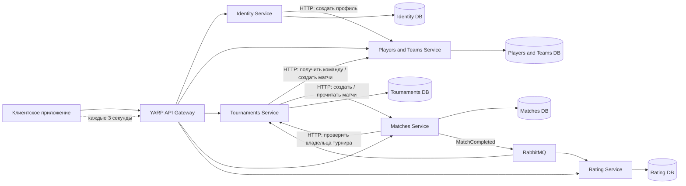
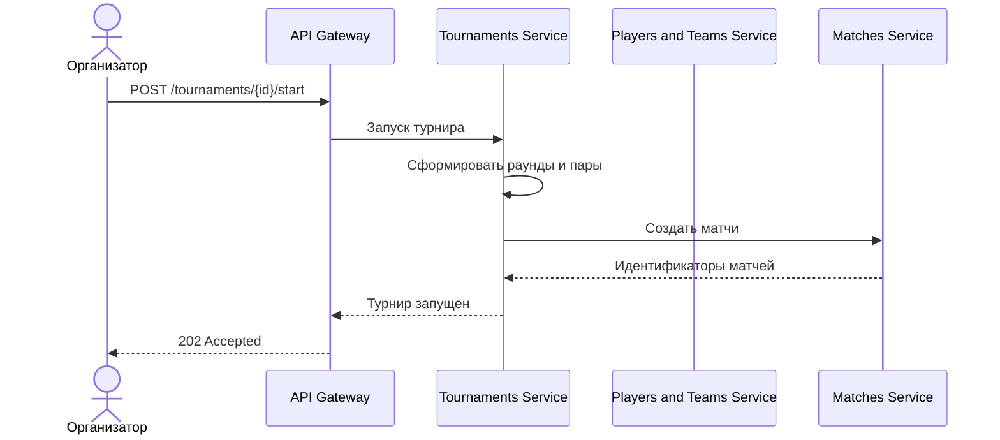
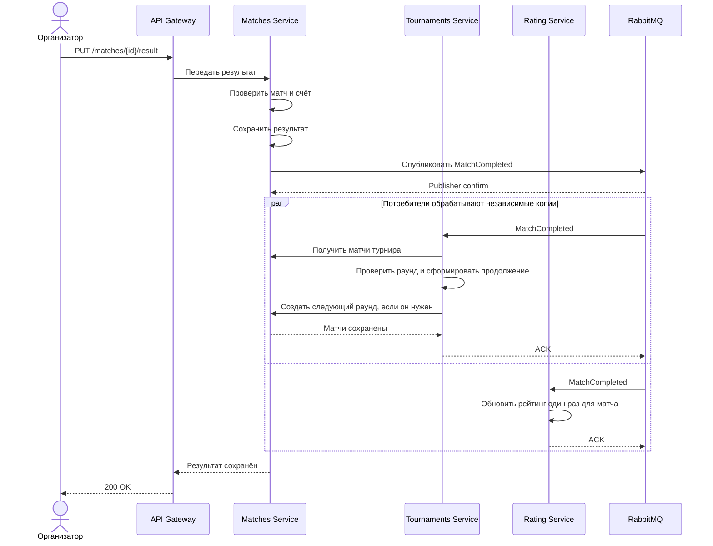

# Архитектура системы

## 1. Цель и контекст

TournamentPlatform — платформа для создания и проведения командных турниров. Игроки регистрируются в системе и объединяются в команды; в турнирах участвуют только команды, а рейтинг Эло рассчитывается только для команд. Пользователи могут просматривать турниры, матчи и командные рейтинги; организаторы создают турниры и фиксируют результаты.

Основные сценарии:

1. Организатор создаёт турнир, выбирает формат и открывает регистрацию.
2. Владелец команды подаёт её заявку на участие.
3. Организатор запускает турнир, система формирует матчи.
4. Организатор фиксирует результат матча.
5. Система обновляет турнирную сетку и рейтинг команд.
6. Сервисы получают событие завершённого матча и отдельно обновляют сетку и рейтинг.

Система поддерживает олимпийскую, круговую и швейцарскую системы. Лента событий в проект не входит.

## 2. Требования

### Функциональные требования

- Создание и просмотр профилей игроков и команд.
- Управление составом команды.
- Создание командных турниров, регистрация команд и управление статусом турнира.
- Генерация матчей и турнирной сетки или расписания.
- Фиксация результатов матчей и продвижение победителей.
- Расчёт и просмотр рейтинга Эло только для команд.
- Передача завершённых матчей между сервисами через RabbitMQ.

### Нефункциональные требования и ограничения

- Сервисы запускаются локально одной командой через Docker Compose.
- Каждый сервис владеет своей базой данных и не читает таблицы других сервисов напрямую.
- Защищённые операции требуют JWT-аутентификации; доступ к управлению проверяется по владельцу ресурса. Полноценные роли пока не реализованы.
- Повторная обработка сообщения не должна повторно менять рейтинг; Rating Service хранит ID уже учтённых матчей.
- Уже зафиксированный результат нельзя заменить другим; отдельной проверки конкурентных изменений нет.
- Автоматические тесты проверяют часть валидаций API и бизнес-правил; генераторы сеток и формула Эло тестами сейчас не покрыты.
- Приложения используют стандартное логирование ASP.NET Core и имеют `/health`; отдельные correlation ID не настроены.

## 3. Общая схема

Клиент обращается к сервисам через API Gateway. Сервисы обмениваются запросами через HTTP API, а завершение матча публикуется через RabbitMQ. Tournaments Service и Rating Service обрабатывают событие независимо..



В Compose настроены пять отдельных баз PostgreSQL, но все сервисы используют учётную запись `tournament`, которая владеет всеми базами. Приложения используют собственные строки подключения и не читают чужие таблицы напрямую, однако строгой изоляции прав на уровне PostgreSQL нет. Внешние сущности представлены идентификаторами; межбазовых внешних ключей нет.

## 4. Описание сервисов

### API Gateway

**Ответственность:** единая точка входа, раздача статического веб-клиента и маршрутизация API-запросов через YARP. Gateway не проверяет JWT и не реализует бизнес-авторизацию; это делают сервисы назначения.

**База данных:** отсутствует.

**Основные маршруты:** `/api/v1/auth/**` → Identity; `/api/v1/players/**` и `/api/v1/teams/**` → Players; `/api/v1/tournaments/**`, `/api/v1/matches/**`, `/api/v1/ratings/**` → соответствующие сервисы. Веб-клиент отдаётся с корневого адреса.

**События:** не публикует и не потребляет.

### Identity Service

**Ответственность:** регистрация и аутентификация пользователей, выпуск JWT. Ролевая модель пока не настроена.

**Основные эндпоинты:**

- `POST /api/v1/auth/register`
- `POST /api/v1/auth/login`
- `GET /health`

**Своя БД:** таблицы ASP.NET Core Identity с пользователями и хэшами паролей; роли в приложении не используются.

**События:** для первой версии не публикует и не потребляет.

### Players and Teams Service

**Ответственность:** профили игроков, команды и составы команд.

**Основные эндпоинты:**

- `GET /api/v1/players/{userId}`
- `GET /api/v1/players`
- `POST /internal/player-profiles` — внутренний вызов Identity после регистрации.
- `POST /api/v1/teams`
- `GET /api/v1/teams/{teamId}`
- `GET /api/v1/teams`
- `POST /api/v1/teams/{teamId}/members`
- `DELETE /api/v1/teams/{teamId}/members/me`
- `DELETE /api/v1/teams/{teamId}/members/{playerId}`
- `DELETE /api/v1/teams/{teamId}`

**Своя БД:** `PlayerProfiles`, `Teams`, `TeamMembers`. Никнейм профиля уникален; участник определяется парой team ID и user ID.

**События:** для первой версии не публикует и не потребляет.

### Tournaments Service

**Ответственность:** создание командных турниров, регистрация команд, переходы между статусами, правила формата, просмотр турнирной сетки или расписания.

**Основные эндпоинты:**

- `POST /api/v1/tournaments`
- `GET /api/v1/tournaments`
- `GET /api/v1/tournaments/{tournamentId}`
- `POST /api/v1/tournaments/{tournamentId}/teams`
- `POST /api/v1/tournaments/{tournamentId}/start`
- `POST /internal/tournaments/{tournamentId}/authorize-manager` — внутренняя проверка владельца для Matches.
- `POST /internal/tournaments/{tournamentId}/matches/{matchId}/completed`

**Своя БД:** турниры и зарегистрированные идентификаторы команд (`TournamentTeams`).

Для формата сохраняются максимальное число команд (`MaxTeams`), число раундов (для швейцарской системы) и статус турнира. Раунды и матчи хранятся в Matches Service.

**Публикуемые события:** не публикует.

**Потребляемые события:** `MatchCompleted`; проверяет состояние раунда и при необходимости создаёт следующий раунд. Для этого использует HTTP API Matches Service.

### Matches Service

**Ответственность:** создание и хранение матчей, проверка и фиксация результатов.

**Основные эндпоинты:**

- `GET /api/v1/matches/{matchId}`
- `GET /api/v1/matches/tournaments/{tournamentId}`
- `PUT /api/v1/matches/{matchId}/result`
- `POST /internal/matches/batch`

**Своя БД:** таблица `Matches`: турнир, номер раунда, тип и ID участников, счёт, победитель, статус и время завершения. Турниры поддерживают только команды; пустой участник B означает bye.

**Публикуемые события:** `MatchCompleted` после сохранения результата матча.

**Потребляемые события:** не потребляет.

### Rating Service

**Ответственность:** расчёт и предоставление рейтинга Эло команд. Рейтинговых эндпоинтов и записей для игроков нет.

**Основные эндпоинты:**

- `GET /api/v1/ratings/teams/{teamId}`
- `GET /api/v1/ratings/leaderboard?limit=50`
- `POST /internal/ratings/matches` — внутреннее начисление рейтинга за завершённый командный матч.

**Своя БД:** `Ratings` (составной ключ тип участника + ID, значение, количество матчей и время изменения) и `ProcessedMatches` для защиты от повторного начисления.

**Публикуемые события:** не публикует.

**Потребляемые события:** `MatchCompleted`; пересчитывает рейтинг команд.

### Событие `MatchCompleted`

Сообщение публикуется Matches Service в exchange `tournament.events` с routing key `match.completed`. Очереди `tournaments.match-completed` и `rating.match-completed` получают отдельную копию события. Сообщение содержит ID матча и турнира, ID двух команд, счёт, победителя и время завершения. Exchange и очереди durable; сообщение persistent, а публикация ожидает publisher confirm. Потребители подтверждают сообщение после успешной обработки и возвращают его в очередь при временной ошибке. Rating Service защищает начисление от повтора по ID матча; продолжение сетки безопасно при повторной доставке.

Тело события:

```json
{
  "matchId": "10b2a9cd-13d2-4d66-a144-42d06e550ab1",
  "tournamentId": "9fa47e15-2493-417a-9592-347d9f84f85d",
  "teamAId": "05fe6c05-8c49-4456-97bf-4ec700fbf25c",
  "teamBId": "30be4f53-5c00-4b42-991f-671019207a18",
  "scoreA": 2,
  "scoreB": 1,
  "winnerId": "05fe6c05-8c49-4456-97bf-4ec700fbf25c",
  "completedAt": "2026-11-16T12:00:00Z"
}
```

## 5. Модель данных

### Identity Service

- Таблицы ASP.NET Core Identity: учётные записи пользователей, email, нормализованные имена и хэш пароля. Роли не назначаются и не проверяются.

### Players and Teams Service

- `PlayerProfiles`: `UserId`, уникальный `Nickname`, дата создания.
- `Teams`: `Id`, `Name`, `OwnerId`, дата создания.
- `TeamMembers`: `TeamId`, `UserId`, дата вступления. Составной первичный ключ — команда и пользователь; роли состава и дата выхода не хранятся.

### Tournaments Service

- `Tournaments`: идентификатор, название, формат (`olympic`, `round_robin` или `swiss`), создатель, лимит команд, число раундов и статус.
- `TournamentTeams`: идентификатор турнира, идентификатор команды и дата регистрации.

### Matches Service

- `Matches`: идентификатор, идентификатор турнира, номер раунда, идентификаторы двух команд, счёт, победившая команда, статус и время завершения.
- Внешние идентификаторы участников и турнира хранятся как значения, проверяемые при обращении к соответствующему сервису.

### Rating Service

- `Ratings`: тип (для актуального проекта всегда `team`), идентификатор команды, значение Эло, число сыгранных матчей и время обновления.
- `ProcessedMatches`: ID матча, рейтинг за который уже начислен.

## 6. Взаимодействие сервисов

### Синхронные вызовы

- Клиент вызывает сервисы через API Gateway.
- Tournaments Service при регистрации команды проверяет её существование и владельца через Players and Teams Service; запуск использует зарегистрированные команды.
- Tournaments Service передаёт сформированные матчи в Matches Service.
- Matches Service обращается к Tournaments Service по HTTP для проверки прав организатора перед сохранением результата.
- После сохранения результата Matches Service публикует `MatchCompleted`. Tournaments Service продолжает сетку, а Rating Service обновляет Эло независимо друг от друга.
- Чтение публичных данных выполняется через API соответствующего сервиса.

### Асинхронные события

RabbitMQ используется для асинхронной передачи результата. Ответ на фиксацию матча подтверждает сохранение результата и публикацию события; создание следующего раунда и пересчёт рейтинга происходят отдельно.

### Сценарий: запуск турнира



### Сценарий: завершение матча



## 7. Безопасность

- Аутентификация выполняется через Identity Service.
- Клиент получает JWT после входа и передаёт его в заголовке `Authorization: Bearer`.
- В JWT находятся `sub` (ID пользователя) и `nickname`; role claim нет. Создание турнира и запуск требуют действительный JWT. Создатель турнира сохраняется как организатор; запустить турнир может только он.
- Зарегистрировать команду может только её владелец с действительным JWT. Индивидуальная регистрация игрока в турнире не поддерживается. Фиксировать результаты и управлять раундами может только организатор турнира.
- Matches Service проверяет право организатора через внутренний запрос к Tournaments Service до сохранения результата.
- Списки и карточки турниров и матчей доступны без авторизации.
- Пароли хранятся только в виде хэшей средствами ASP.NET Core Identity.
- В локальном `docker-compose.yml` заданы демонстрационные JWT-ключ и пароли PostgreSQL/RabbitMQ. Это не production-конфигурация; при развёртывании секреты нужно вынести в защищённое хранилище.
- Неверный или отсутствующий JWT приводит к `401 Unauthorized`; действительный JWT без нужных прав — к `403 Forbidden`.
- Автоматические GET-запросы клиента используют те же правила доступа, что и обычные запросы API.

## 8. Развёртывание и конфигурация

Локальная система запускается через Docker Compose. В состав входят API Gateway, пять сервисов, PostgreSQL и RabbitMQ. Каждый сервис получает строку подключения к отдельной логической базе PostgreSQL; все используют общий локальный логин `tournament`.

Распределение портов для локальной разработки:

| Компонент | Порт хоста |
|---|---:|
| API Gateway | 8080 |
| Identity, Players, Tournaments, Matches, Rating (внутри Compose-сети) | 8080 каждый |
| PostgreSQL | 5432 |
| RabbitMQ AMQP | 5672 |
| RabbitMQ Management UI | 15672 |

С компьютера опубликован только Gateway на `8080`; PostgreSQL — на `5432`, RabbitMQ AMQP — на `5672`, панель RabbitMQ — на `15672`. API сервисов доступны внутри Compose-сети по именам контейнеров и порту `8080`.

Пример переменных окружения:

Compose задаёт переменные `ConnectionStrings__Identity`, `ConnectionStrings__Players`, `ConnectionStrings__Tournaments`, `ConnectionStrings__Matches`, `ConnectionStrings__Rating`, `Jwt__Key`, адреса внутренних сервисов и `RabbitMQ__Host/Port/Username/Password`.

Заданы версии образов PostgreSQL и RabbitMQ. В Development приложения вызывают EF Core `EnsureCreated`; некоторые сервисы выполняют дополнительные SQL-команды для совместимости схемы. EF Core migrations и команда их применения не настроены. Health checks Compose заданы для PostgreSQL и RabbitMQ, но не для API-контейнеров. `/health` приложений проверяет доступность процесса, а не все зависимости.

## 9. Принятые решения

| Решение | Альтернатива | Причина |
|---|---|---|
| Отдельный сервис рейтинга | Считать рейтинг внутри Matches Service | Расчёт рейтинга можно тестировать и изменять независимо от жизненного цикла матча |
| RabbitMQ для завершённых матчей | Синхронный вызов Rating Service из Matches Service | Очередь снижает связанность и позволяет повторить обработку после временного сбоя |
| Периодический опрос API для автообновления клиента | SignalR или WebSocket | Для учебного клиента не нужна отдельная библиотека; обновление приходит с задержкой до 3 секунд |
| Нет transactional outbox | Сохранение исходящего события вместе с матчем в одной транзакции | Упрощение учебной версии; при сбое после записи матча нужно повторить публикацию |

## 10. Ограничения и развитие

- Результаты в первой версии вводит организатор.
- Клиент получает обновления периодическим опросом API с интервалом 3 секунды, а не через постоянное соединение.
- Полноценные роли JWT не реализованы; сервисы сравнивают ID пользователя с владельцем ресурса.
- Нет transactional outbox, EF Core migrations, отдельных DB-пользователей сервисов, correlation ID и настроенных Swagger/OpenAPI endpoints.
- Тесты проверяют часть API-валидаций через EF InMemory; генерация сеток и расчёт Эло отдельными тестами не покрыты.
- Масштабирование и отказоустойчивость рассчитаны на учебный проект, а не на высоконагруженную коммерческую платформу.
- Возможное развитие: рейтинговые сезоны, история рейтинга на графике, уведомления.

## 11. Контракты API

Базовый адрес API: `http://localhost:8080/api/v1`. Все тела запросов и ответов используют JSON. Идентификаторы передаются в формате UUID, дата и время — в UTC по ISO 8601.

Для защищённых операций клиент передаёт JWT в заголовке `Authorization: Bearer <token>`. Ошибки возвращаются в формате `ProblemDetails`:

```json
{
  "type": "about:blank",
  "title": "Conflict",
  "status": 409,
  "detail": "Турнир уже запущен.",
  "instance": "/api/v1/tournaments/9fa47e15-2493-417a-9592-347d9f84f85d"
}
```

Основные коды ошибок: `400` — неверные данные, `401` — требуется вход, `403` — недостаточно прав, `404` — ресурс не найден, `409` — конфликт состояния или повторная операция, `412` — версия ресурса устарела.

### Игроки

#### Создать учётную запись и профиль игрока

`POST /auth/register` — создаёт учётную запись и связанный с ней базовый профиль игрока.

Запрос:

```json
{
  "email": "player@example.com",
  "nickname": "PlayerOne",
  "password": "demo1234"
}
```

При успешном запросе возвращается `201 Created`:

```json
{
  "userId": "a72dc499-589a-4480-8f44-7b1d4bf1f433",
  "nickname": "PlayerOne",
  "email": "player@example.com"
}
```

После создания учётной записи Identity Service вызывает Players Service внутренним запросом `POST /internal/player-profiles` с `userId` и `nickname`. Этот внутренний маршрут не является клиентским API.

#### Получить профиль игрока

`GET /players/{playerId}` — публичный.

Ответ `200 OK` возвращает профиль.

#### Найти игроков

`GET /players?query=player&limit=20` — публичный. Параметры `query` и `limit` необязательны; максимальный `limit` — 100. Ответ `200 OK` содержит массив профилей.

### Команды

#### Создать команду

`POST /teams` — требуется JWT зарегистрированного игрока. Создатель становится владельцем и первым участником команды.

Запрос:

```json
{
  "name": "Team Alpha"
}
```

Ответ `201 Created`:

```json
{
  "id": "05fe6c05-8c49-4456-97bf-4ec700fbf25c",
  "name": "Team Alpha",
  "ownerId": "a72dc499-589a-4480-8f44-7b1d4bf1f433",
  "members": ["a72dc499-589a-4480-8f44-7b1d4bf1f433"]
}
```

#### Получить команду и её состав

`GET /teams` возвращает список команд. `GET /teams/{teamId}` — публичный; ответ `200 OK`:

```json
{
  "id": "05fe6c05-8c49-4456-97bf-4ec700fbf25c",
  "name": "Team Alpha",
  "ownerId": "a72dc499-589a-4480-8f44-7b1d4bf1f433",
  "members": ["a72dc499-589a-4480-8f44-7b1d4bf1f433"]
}
```

#### Вступить в команду, выйти и исключить участника

- `POST /teams/{teamId}/members` — игрок с JWT вступает сам; тело запроса не требуется. Успешный ответ: `204 No Content`.
- `DELETE /teams/{teamId}/members/me` — игрок выходит сам; успешный ответ: `204 No Content`. Владелец не может выйти, пока команда существует.
- `DELETE /teams/{teamId}/members/{playerId}` — владелец исключает участника; успешный ответ: `204 No Content`. Владелец не может исключить себя.
- `DELETE /teams/{teamId}` — владелец удаляет команду и её состав; успешный ответ: `204 No Content`.

Изменение состава и удаление команды требуют JWT. Если команда или участник не найдены, возвращается `404`; если операцию выполняет не владелец либо она запрещена текущим состоянием — `403` или `409`.

### Турниры

#### Создать турнир

`POST /api/v1/tournaments` — создать командный турнир. Запрос требует JWT; создатель становится организатором и может запускать турнир и фиксировать его результаты.

```json
{
  "name": "Autumn Cup",
  "format": "round_robin",
  "maxTeams": 16
}
```

Допустимые значения `format`: `olympic`, `round_robin`, `swiss`. Ответ `201 Created` содержит ID, название, формат, максимальное число команд, создателя, статус и дату создания. Матчи при создании турнира не формируются.

Лимиты по форматам: олимпийская система — 2–128 команд, круговая — 2–16, швейцарская — 2–256. Для `swiss` обязательно передать `roundCount` от 1 до 20; для остальных форматов это поле не допускается.

#### Просмотр турниров

- `GET /api/v1/tournaments` — список турниров, публичный; ответ `200 OK` — массив.
- `GET /api/v1/tournaments/{id}` — сведения о турнире, публичный; ответ `200 OK` — объект турнира.

#### Зарегистрировать команду

`POST /api/v1/tournaments/{id}/teams` — владелец команды подаёт её заявку; требуется JWT. Сервис проверяет команду в Players and Teams Service и сравнивает `ownerId` команды с пользователем из токена.

```json
{
  "teamId": "05fe6c05-8c49-4456-97bf-4ec700fbf25c"
}
```

Ответ `201 Created`; `409 Conflict` возвращается, если регистрация закрыта, команда уже зарегистрирована или достигнут лимит команд.

```json
{
  "tournamentId": "9fa47e15-2493-417a-9592-347d9f84f85d",
  "teamId": "05fe6c05-8c49-4456-97bf-4ec700fbf25c"
}
```

#### Запустить турнир

`POST /api/v1/tournaments/{id}/start` — запускает турнир после регистрации минимум двух команд. Запустить может только организатор.

Ответ `202 Accepted`:

```json
{
  "tournamentId": "9fa47e15-2493-417a-9592-347d9f84f85d",
  "status": "in_progress",
  "generatedRounds": 1
}
```

Получить матчи турнира: `GET /api/v1/matches/tournaments/{tournamentId}`. После сохранения результатов система продолжает сетку автоматически.

### Матчи

#### Получить матч или матчи турнира

- `GET /api/v1/matches/{matchId}` — получить матч.
- `GET /api/v1/matches/tournaments/{tournamentId}` — получить все матчи турнира.

Пример объекта матча. `participantAId`, `participantBId` и `winnerId` содержат именно ID команд; матч игрока API не возвращает.

```json
{
  "id": "10b2a9cd-13d2-4d66-a144-42d06e550ab1",
  "tournamentId": "9fa47e15-2493-417a-9592-347d9f84f85d",
  "round": 1,
  "participantType": "team",
  "participantAId": "05fe6c05-8c49-4456-97bf-4ec700fbf25c",
  "participantBId": "30be4f53-5c00-4b42-991f-671019207a18",
  "scoreA": null,
  "scoreB": null,
  "winnerId": null,
  "status": "scheduled"
}
```

#### Зафиксировать результат

`PUT /api/v1/matches/{matchId}/result` принимает счёт матча. Счёт должен быть неотрицательным и определять победителя; ничья не поддерживается. Попытка изменить сохранённый результат возвращает `409 Conflict`. Успешный ответ означает, что результат сохранён и событие подтверждено RabbitMQ; продолжение турнира и расчёт Эло выполняются асинхронно.

```http
PUT /api/v1/matches/10b2a9cd-13d2-4d66-a144-42d06e550ab1/result
Content-Type: application/json
```

```json
{
  "scoreA": 2,
  "scoreB": 1
}
```

Ответ `200 OK`:

```json
{
  "id": "10b2a9cd-13d2-4d66-a144-42d06e550ab1",
  "tournamentId": "9fa47e15-2493-417a-9592-347d9f84f85d",
  "round": 1,
  "participantType": "team",
  "participantAId": "05fe6c05-8c49-4456-97bf-4ec700fbf25c",
  "participantBId": "30be4f53-5c00-4b42-991f-671019207a18",
  "scoreA": 2,
  "scoreB": 1,
  "winnerId": "05fe6c05-8c49-4456-97bf-4ec700fbf25c",
  "status": "completed",
  "completedAt": "2026-11-12T15:30:00Z"
}
```

После фиксации счёта Matches Service публикует событие. Tournaments Service обрабатывает его отдельно: круговой турнир завершается после всех матчей; в олимпийской сетке победители автоматически переходят в следующий раунд, а BYE учитываются как технические победы; в швейцарской сетке следующий раунд формируется по числу побед с попыткой не повторять соперников и с BYE при нечётном числе команд.

Если потребитель временно не может обработать событие, он не подтверждает его и сообщение возвращается в очередь. Публикация выполняется после сохранения матча без transactional outbox: при недоступности RabbitMQ API вернёт `503`, и отправитель может повторить отправку того же результата.

### Рейтинг

Рейтинг команды автоматически пересчитывается Rating Service после каждого завершённого матча. Участники турниров всегда команды; рейтинг игроков не рассчитывается и соответствующего публичного API нет. Начальные рейтинги команд из демонстрационного топ-10 совпадают с очками HLTV; остальные команды получают 1000 при первом завершённом матче. Для дальнейших изменений используется коэффициент K=32. Клиент не может напрямую задавать значение рейтинга; повторная обработка одного матча не начисляет рейтинг второй раз.

- `GET /api/v1/ratings/teams/{teamId}` — получить рейтинг команды; для команд из начального топ-10 HLTV доступен сразу, для остальных — после первого завершённого матча.
- `GET /api/v1/ratings/leaderboard?limit=50` — таблица лидеров команд. `limit` по умолчанию равен 50 и не может превышать 100.

Пример ответа с рейтингом команды (`200 OK`):

```json
{
  "teamId": "05fe6c05-8c49-4456-97bf-4ec700fbf25c",
  "value": 1016,
  "matchesPlayed": 1,
  "updatedAt": "2026-11-12T15:30:00Z"
}
```

Таблица лидеров возвращается как массив объектов такого формата с полем `teamId`.

### Автообновление интерфейса

Пока вкладка открыта и пользователь вошёл в систему, клиент каждые 3 секунды повторяет GET-запросы для текущего раздела через API Gateway. Используются существующие эндпоинты списков игроков, команд, турниров, матчей и рейтинга. Отдельного SignalR Hub или WebSocket endpoint нет.
